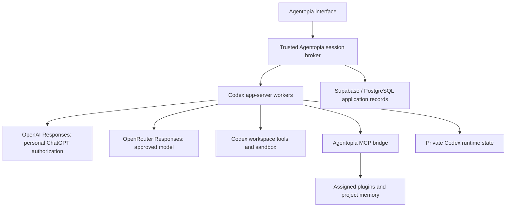

# Using the Codex harness in Agentopia

Research date: October 16, 2026. Current Agentopia desktop: 0.25.1. Original status: architecture recommendation. Implementation followed in Agentopia 0.27.1; see [native Codex implementation](native-codex.md) for the pinned runtime, V1 compatibility decision, live evidence, and remaining limits.

## Decision

Use the actual, version-pinned **Codex app-server** as the preferred agent runtime for both the personal ChatGPT connection and qualified OpenRouter models. Keep Agentopia's Electron interface, Supabase accounts, PostgreSQL application data, plugin administration, and protected credential broker around that runtime.

The evidence does **not** require an OpenAI/Codex harness and an OpenRouter/custom harness split. Codex supports custom Responses-compatible providers, and OpenRouter explicitly documents configuring Codex against its Responses endpoint. This establishes a documented integration path, rather than proof that every OpenRouter model or Codex feature works in our installation. [OpenAI custom-provider configuration](https://learn.chatgpt.com/docs/config-file/config-advanced#custom-model-providers), [OpenRouter's Codex guide](https://openrouter.ai/blog/tutorials/codex-cli-openrouter/).

Separate **connection configuration, credentials, and runtime state**. Prefer one runtime implementation. Retain the existing custom runtime as an explicitly labelled compatibility option during migration and for models that fail qualification. Never switch to it silently after a Codex failure.

## What was checked

This research read the current official app-server, provider, authentication, Windows sandbox, state, SDK, and managed Agents API documentation, plus OpenRouter's Codex and Responses documentation. Local inspection checked Agentopia's execution loop, provider adapters, plugin enforcement, credential storage, shared contracts, and recorded verification boundaries.

The globally installed command reports `codex-cli 0.144.4`. Its `app-server --help` exposes stdio transport, configuration overrides, and version-specific TypeScript/JSON schema generation. This confirms the local command exists; it does not establish compatibility with every feature in the current online documentation. Agentopia currently bundles no Codex runtime and calls its own provider adapters directly.

No credentials were read or exported, no inference requests were submitted, no application connections were changed, and no runtime was upgraded. Existing real-provider tests exercised our custom harness. They do not qualify Codex through either connection.

## Runtime options

| Option | What it provides | Fit for Agentopia |
|---|---|---|
| Local Codex app-server | Real Codex runtime with a bidirectional client protocol | Recommended for the interactive Windows product |
| Codex SDK | Programmatic control of local Codex threads | Useful for automated jobs and evaluation; app-server is the documented choice for rich clients |
| OpenAI-managed Agents API | Hosted Codex harness, session management, and selectable execution environment | Separate future deployment option; its documentation does not establish OpenRouter routing or reuse of our ChatGPT-plan connection |
| General Agents SDK | An agent runner configured by the application | Adopting it would not establish that we run the Codex harness |
| Current Agentopia loop | Our direct model requests, tools, approvals, and continuation | Keep temporarily for existing chats and explicitly supported compatibility cases |

OpenAI directs custom clients needing interactive approvals and events toward app-server, and automation toward the Codex SDK. [App-server](https://learn.chatgpt.com/docs/app-server), [Codex SDK](https://learn.chatgpt.com/docs/codex-sdk). The managed alternative runs remotely and uses API billing; it should be evaluated as a distinct product decision. [Agents API](https://developers.openai.com/api/docs/guides/agents-api/overview), [runtime comparison](https://developers.openai.com/api/docs/guides/agents).

## Connection routing

| Agentopia connection | Target runtime | Inference route | Qualification required |
|---|---|---|---|
| Personal Continue with ChatGPT | Codex app-server | Authorized OAuth token to `https://api.openai.com/v1/responses` | Existing entitlement plus actual Codex tool and continuation turns |
| OpenAI API key, if added later | Codex app-server | Configured OpenAI API provider | Separate API credentials and billing |
| OpenRouter, beginning with `openai/gpt-6.1-sol` | Same Codex app-server implementation | Responses provider at `https://openrouter.ai/api/v1` | Exact runtime, model, metadata, routing, and tool compatibility |
| Other OpenRouter models | Same runtime when qualified | Same Responses endpoint | Qualify each model; expose its actual capabilities |
| Models that cannot satisfy Codex's contract | Explicit custom compatibility runtime, or unavailable | Existing adapter where supported | Clearly document different behavior |

Agentopia's existing OpenRouter adapter uses Chat Completions. The new Codex path must use **Responses**; current Codex documentation excludes Chat Completions-only endpoints. [Model/provider requirements](https://learn.chatgpt.com/docs/models#other-models).

For ChatGPT-plan authorization, OpenAI supplies an exact app-server configuration: a custom Responses provider, the application's authorized access token in the child environment, OpenAI-auth delegation disabled, and WebSockets disabled. Our application retains responsibility for token renewal; with that environment-token arrangement, restart the worker and resume its saved thread after renewal. Do not assume an arbitrary token can be passed into the experimental native-Codex account-token login mode. Follow the documented path for the authorization we already own. [Sign in with ChatGPT app-server integration](https://developers.openai.com/siwc/token-sharing-open-source/codex-app-server).

OpenRouter documents a distinct provider identifier, its full model slug, Responses transport, and command-backed authentication for catalog discovery. Verify the selected release's actual discovery behavior and metadata; plain `/models` data is not a Codex-native capability catalog. Use a reviewed, version-matched catalog if necessary. [OpenRouter Codex configuration](https://openrouter.ai/blog/tutorials/codex-cli-openrouter/), [catalog preparation](https://learn.chatgpt.com/docs/enterprise/roll-out-a-gateway#use-a-model-catalog-for-custom-names).

## Recommended integration boundary

This is a proposed architecture. The broker verifies the Supabase account and ownership, selects the connection and agent capability scope, manages worker lifecycle, and projects runtime events into the interface and database. It does not run a second model/tool loop around Codex.

Use a private stdio child process and generated protocol bindings. Keep the protocol behind Electron's trusted process boundary. Generate bindings from the exact bundled executable and fail clearly on an unsupported protocol. Map native turn, item, approval, and interruption events without converting every runtime item into ordinary chat text.

Worker isolation should include the Agentopia user, connection, and effective tool/permission scope. If two agents have different plugin grants, use independently scoped workers or a bridge that enforces the correct thread principal on every operation. Never give a worker all users' connections and depend on instructions to select the right one.

Do not reuse the person's ordinary Codex home directory. Give Agentopia separate runtime homes and stop its workers on sign-out. Preserve default Codex instructions and add agent/project guidance through supported instruction mechanisms. Replacing Codex's base instructions with our current assembled prompt would change the behavior we are trying to retain.

## Capabilities and the work they require

| Capability | Recommended owner and implementation work |
|---|---|
| Reasoning, tool selection, continuation | Codex owns the loop. Remove the current nine-round/24-call orchestration from Codex-routed turns; retain explicit product budgets separately. |
| Context and long conversations | Codex owns thread context and compaction. Configure only provider-supported compaction behavior and test it under real context pressure. |
| Commands, file edits, and approvals | Use Codex workspace tools and its sandbox. Translate real approval requests into Agentopia controls. Avoid duplicate shell/file tools with weaker boundaries. |
| Plan mode | Use the selected release's native collaboration mode and permission controls. Map its plan events into the canvas; ensure side-effecting plugin calls are withheld too. |
| Goals and child agents | Qualify native goal/child-agent behavior and expose actual state. Preserve Agentopia scheduling only where needed, without two competing continuation loops. |
| Skills and repository instructions | Use native loading and discovery. Add assigned, reviewed skill roots; test precedence and project trust. |
| Plugins | Expose assigned, validated tools through an Agentopia MCP bridge. Keep credentials, ownership checks, schema checks, and existing external-operation approvals at that bridge. |
| Project memory | Expose our owned PostgreSQL retrieval as a scoped tool. Codex's context handling and Agentopia's cross-chat retrieval serve different purposes. |
| History, settings, accounts | Supabase remains the application authority. Store Codex session references and an idempotent display/audit projection. |
| Browser, canvas, voice, connected apps | Continue implementing the required host tools and UI. Bundling app-server does not supply the whole desktop application's integrations. |

Dynamic client tools are another integration option, but the documentation marks their protocol experimental. Start with the stable supported MCP route where possible and keep host authorization mandatory. Runtime support for skills or plugins does not grant access to OpenAI's private app directory or services.

The ChatGPT-plan preview permits local shell/MCP tools and child-agent coordination, while restricting several hosted tools and request fields. Configurations that emit unsupported `tool_search` fail; voice transcription and native computer-use access are not supplied by this authorization. Capability controls must reflect the chosen route. [Preview restrictions](https://developers.openai.com/siwc/token-sharing-open-source/preview-limitations).

## Windows, credentials, and database consequences

Run the Codex worker natively on Windows first, matching our Windows paths and shell workflow. Keep the managed WSL distribution for Supabase. Select and test a Codex Windows sandbox supported by the pinned release and this device; current documentation describes MXC and legacy fallbacks. Approval prompts and filesystem/network enforcement are separate controls. [Windows sandbox](https://learn.chatgpt.com/docs/windows/windows-sandbox).

Our existing selected-files, Default, Full access, and administrator command restrictions need explicit mappings. Native workspace permissions may allow approved-root edits without asking about every change. Do not retain an identical label while silently broadening its effect. In particular, the documented `thread/shellCommand` and experimental process APIs have different execution boundaries from ordinary agent commands; do not expose them as substitutes for sandboxed agent tools.

Keep the shared OpenRouter administrator key in the trusted broker. For deployment, prefer a small provider gateway that issues scoped worker credentials and forwards only authorized inference to OpenRouter. This gateway changes credential delivery, not the agent loop. Restrict models and user attribution, revoke access on sign-out, and sanitize diagnostics. Test that agent-run commands cannot retrieve master keys, other users' tokens, broker credentials, or private runtime records. Passing the master key into a child's environment without proving shell isolation would weaken the existing design. Personal ChatGPT tokens also require protected delivery and shell-environment filtering.

**Supabase/PostgreSQL remains our application database. Codex also maintains its own local runtime state, including a SQLite-backed state database.** This is documented through `CODEX_HOME` and `sqlite_home`. We cannot promise an unchanged upstream Codex harness with all internal state moved into PostgreSQL. Back up its private runtime files together with the corresponding Supabase references. If a strict ban on any SQLite files is required, that becomes an additional architectural constraint and may require a substantial upstream fork or another deployment model. [State locations](https://learn.chatgpt.com/docs/config-file/config-advanced#config-and-state-locations), [configuration reference](https://learn.chatgpt.com/docs/config-file/config-reference).

Use additive migrations for runtime type/version, connection scope, runtime thread identifier, and stable turn/item mappings. Preserve existing accounts, passwords, agents, conversations, and migrations. A transcript in PostgreSQL is insufficient to reconstruct an exact native Codex session after losing its runtime state.

Existing chats remain readable and continue with their recorded runtime. Offer an explicit continuation into a new Codex thread with selected historical context. Do not present that import as recovery of a pre-existing Codex session. Initially branch explicitly when changing connection too; preserve lineage and move readable context rather than replaying provider-specific reasoning or tool continuations across accounts. Later, allow seamless changes only after the exact transition is qualified.

## OpenRouter compatibility gates

OpenRouter's Responses API is stateless: send required input history, use `store: false`, and omit `previous_response_id`. Start with HTTP streaming and disable WebSockets. Codex's local threads provide persistence independently of server-side response storage. [OpenRouter Responses](https://openrouter.ai/docs/api_reference/responses/overview).

Before enabling a runtime/model pair, verify:

1. Incremental events, a successful terminal event, and clear failures.
2. Replayed follow-up history, function/custom tools, namespaces, tool-result identifiers, and reasoning-item continuation as emitted by the selected runtime. The public function-tool example alone does not establish every Codex tool format.
3. Native file inspection, patching, commands, and multi-step return from tools to a final answer.
4. Accurate context window, accepted thinking levels, prompt/tool configuration, and provider routing. Do not force every OpenRouter model to use an OpenAI model's metadata.
5. Compaction through a supported route. Disable unsupported remote compaction and qualify Codex's local alternative rather than removing context handling.
6. Any native search, child-agent, or other advanced capability we advertise. Supply scoped MCP search when hosted search is unavailable.

OpenAI's gateway checklist explicitly requires complete tool loops and conversation continuation; one text reply or a successful model-list request is insufficient. [Gateway qualification contract](https://learn.chatgpt.com/docs/enterprise/gateway-compatibility). Reasoning formats and accepted effort vary by model and provider. [OpenRouter reasoning guidance](https://openrouter.ai/docs/guides/best-practices/reasoning-tokens).

## Implementation sequence and acceptance evidence

1. **Isolated feasibility proof.** Select a current release, check redistribution notices and supported Windows binaries, and pin its checksum. Generate that release's protocol bindings. Prove real multi-step tool turns with both existing connections in disposable workspaces. Leave the installed application's default runtime unchanged during this proof.
2. **Runtime adapter and ownership.** Add a runtime interface alongside the existing provider type. Suggested operations: start/resume, submit/steer, interrupt, answer approval, inspect capabilities, and shut down. Implement the Codex protocol transport, session registry, isolation, and credential gateway. Keep legacy execution explicit.
3. **Storage and recovery.** Add session/event mappings and preserve native state. Test duplicate and reordered events, worker restart, token renewal, sign-out, interrupted tools, upgrade backup, and recovery without repeating uncertain side effects.
4. **Capabilities and UI.** Connect native approvals, permission profiles, instructions, plans/goals, skills, child-agent events, and the scoped plugin/memory bridge. Use measured capabilities to enable controls. Disable competing legacy loops on Codex sessions.
5. **Behavioral qualification.** Compare standalone Codex and embedded Codex using the same binary, model, instructions, tools, workspace snapshot, permissions, and budgets. Repeat representative tasks and compare completion, correct changes, verification, permissions, recovery, and context retention. Record deliberate Agentopia policy differences.
6. **Provider qualification and rollout.** Repeat with the OpenRouter model and route. Compare OpenAI and OpenRouter separately from the embedding comparison. Test failed tools, invalid auth, limits, cancellation, context pressure, and connection changes. Package the pinned runtime and Windows resources; preserve current accounts and histories in an installed upgrade test.

Acceptance should produce a per-connection/model capability record with the executable version/hash, supported features, test inputs, observable tool activity, permission decisions, and results. Same runtime does not guarantee identical responses: model differences, provider transformations, instructions, available tools, policy, and model variation still affect behavior.

A second custom harness becomes necessary only for a specifically required model or feature that cannot satisfy Codex's provider contract and cannot be supported through an acceptable provider adapter. Record the failing requirement before making that split. The recommended default remains **one real Codex harness, independently configured and qualified connections**.
