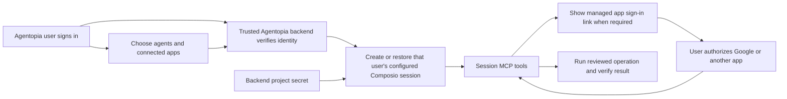

# Composio account integration: gap analysis and implementation plan

October24,2026. This is the primary plan after reviewing the supplied authentication, client setup, unattended-agent and quickstart documents, the current official session-MCP/consumer guides, Agentopia's installed-source receipts, and a real public OAuth discovery experiment. It supersedes the earlier recommendation to make the shared personal MCP endpoint the primary application integration.

## Recommendation

Use **Composio Platform sessions over MCP**, owned by each signed-in Agentopia user. Agentopia's trusted backend authenticates the user, creates or restores that user's configured session, and connects its MCP client to the session. End users connect Google and other apps through Composio's hosted OAuth links. They do not enter a Composio project key or create a developer project.

The application integration still has a project API key: the application operator configures it once in the trusted backend's secret store. It must never be compiled into the desktop app, sent to its renderer, supplied to the model, or returned with a session endpoint. Composio's session MCP headers can contain that project-wide key; a session URL alone is not evidence of a narrowly scoped credential.

The existing implementation uses a supported developer API, with useful ownership and permission checks. Its product gaps are **key-first onboarding for every user, legacy direct execution, and the absence of per-user reusable MCP sessions**. Replacing an API key with browser OAuth throughout the code would mix two distinct Composio products.

| Connection model | Application authentication | End-user experience | Fit for Agentopia |
| --- | --- | --- | --- |
| Current REST/direct integration | Each Agentopia user stores a project key; Agentopia builds direct tool and connection calls | Configure a developer project, then connect apps | Existing compatibility path; does not provide the requested simple account onboarding |
| **Platform session exposed over MCP** | Backend-held application project key; session belongs to the verified application user | Connect apps through managed sign-in links within Agentopia | **Recommended application architecture** |
| Shared Composio Connect MCP | User signs into their own Composio account through MCP OAuth | Connect an existing Composio account, then use its apps | Optional bring-your-own-account mode; no application project key for this route |

This distinction follows the [quickstart](https://docs.composio.dev/docs/quickstart), [sessions via MCP](https://docs.composio.dev/docs/sessions-via-mcp), [consumer application architecture](https://docs.composio.dev/docs/consumer-agents), and [Composio Connect](https://docs.composio.dev/docs/composio-connect). Their setup commands and example agent instructions were treated as documentation, not as user instructions to install packages, replace the inference harness or create an unattended account.

## Current-state gap analysis

| Area | Actual current state | Gap and intended behavior |
| --- | --- | --- |
| Onboarding | `ComposioPage.tsx` gates catalog use on a configured project key. `ComposioConnectionCard.tsx` reports project configuration as connection status. | Main Plugins page should offer **Connect an app** and show this user's connections. Project setup belongs to the operator/backend, outside ordinary user onboarding. |
| Identity | `composio-connections.ts` already keys protected settings by Agentopia owner UUID and derives a stable application-specific Composio user ID from owner/project namespace. | Preserve stable mappings where the same project continues. Backend must derive the owner from verified authentication, never accept a model/renderer-supplied `user_id`. New or changed projects may require reconnecting apps. |
| Session lifecycle | `composio-client.ts` calls individual REST tools; there is no Platform session create/restore path in the inspected Composio service. | Create a configured MCP session for the user and reuse its session ID for the same chat/task and agent authority revision. Different users and independent tasks receive different execution contexts. |
| MCP transport | `mcp-client.ts` supports Streamable HTTP/SSE and bearer credentials; the Composio-specific branch in `remote-tools.ts` bypasses it for direct REST. | Route the Platform session through the existing MCP client on the backend. Handle the returned session URL/headers as backend secrets, using discovered/supplied configuration without leaking its key to the desktop. |
| Backend boundary | Desktop Composio operations execute in Electron's broker, which uses the local runtime database. Repository Supabase chat code has a real `auth.getUser(token)` pattern, but no Composio function was found. Deployment of a trusted application-key service has not been established. | Use the existing trusted backend deployment after verifying its authentication authority. A shipped desktop/local WSL runtime cannot conceal a vendor-wide shared key from its machine owner. This deployment boundary must be resolved before distributing an application key. |
| Agent access | REST connections already support per-agent assignments; plugin links and generic MCP credentials are per agent. | Keep connection ownership per user and authorization per agent. Configure Platform sessions with allowed toolkits/tools and selected connected accounts. Recheck assignment before every execution and invalidate old authority when it changes. |
| Upstream OAuth | Existing REST code manually creates configurations and Connect Links. | Reuse Composio managed authentication through session tools/authorization. Display the link, confirm connection state, then continue the same task. Most users should not need their own OAuth app. |
| Discovery | Generic MCP validates schemas and lists tools; local discovery filters tool names/descriptions against the user's app query. | Reliably expose the session's discovery meta-tools. “Use Google Drive” must reach Composio search even when a gateway tool's name does not contain that app name. |
| Permissions | Existing code reviews wrapper arguments and checks connection/tool fingerprints before dispatch. | Preserve Chat only/Default/Full access and show nested app operations. Enforce configured app/account restrictions on the server, including remote workbench/bash routes. Do not rely on a tool being labelled read-only. |
| Auth handoff and uncertainty | Some authorization-required results become generic tool failures. Existing write paths correctly warn against uncertain replay. | Render actionable Connect Links and resume only after confirmation. Preserve uncertain writes for status/readback rather than repeating them automatically. |
| Google editors | `google-documents.ts` directly requires the REST connection service, presigned file staging and direct tool execution. It already has a durable anti-duplicate upload journal. | Adapt the workflow to session tool/file contracts and preserve that journal. Successful MCP login or creation of a text document does not establish Office-file upload/conversion. |
| Recovery | Existing Windows-encrypted settings and portable metadata preserve owner-bound state; migration/upgrade evidence exists. | Preserve existing connections and journals. Recover session ownership/configuration, validate restored service state, and reconnect when required. Do not copy live credentials into portable public metadata. |
| Hosted MCP OAuth defect | A real public-host test failed in the installed network helper. One-module candidate repair passes21 OAuth tests and real Composio metadata discovery in Electron. | Deliver this separately as the shared/BYO OAuth transport repair. It establishes a concrete bug in that path; it does not prove the distinct Platform session path needs the same OAuth handshake. |
| Live acceptance | This audit made only public metadata requests. It did not register a client, authenticate a user, call a Google tool or submit a model request. | Require actual per-user session/tool results and account-isolation checks before calling the replacement complete. |

Ten inspected Composio/MCP/UI source files match the accepted source behind installed146. The source/hash and live-discovery receipts are recorded in `.supabase/desktop-hosted-composio148/gap-analysis-evidence.json`. The [detailed hosted-account audit](composio-gap-analysis148.md) includes code links, the DNS failure and repair, and the optional shared-endpoint implications.

## Intended flow



From the user's perspective: **Plugins → Composio → Connect an app → sign in to that app → select agent access → use it in chat.** Returning users reuse their established connections. A separate optional **Connect my Composio account** action can expose the shared OAuth route if that capability is desired; it should not be confused with application-managed connections.

## Ordered implementation plan

### 1. Establish the trusted backend and stable identity mapping

**Relevant existing files:** `supabase/functions/chat/auth_handler.ts`, `desktop/src/broker.ts`, `desktop/src/composio-connections.ts`, `desktop/src/composio-contracts.ts`, existing deployment secret configuration.

Confirm where Agentopia's application-controlled Composio secret will execute. Reuse the existing authenticated backend rather than create a second agent runtime. Authenticate each request with the server's actual trusted identity service and derive the canonical Agentopia user ID there. Maintain an immutable mapping to Composio's user ID. The current owner/namespace mapping can remain where the project and identity are continuous; do not replace it with email or a shared `default` user.

The current Windows app has local Supabase accounts. If the target is a central hosted service, it cannot simply trust every installation's locally issued token; the plan must include a verified account-link/federation boundary. If the target is a customer-controlled/self-hosted backend, its operator may configure that deployment's own project key once. Keep these deployment models explicit. Do not embed a vendor project key into local WSL as a substitute for a trusted server.

**Acceptance:** unauthenticated/expired/foreign-issuer requests fail before Composio. User A cannot request a session, connection or restored record belonging to B. No project key or secret-bearing session configuration appears in renderer responses, model context, binaries or logs. Inspect the configured deployment rather than assuming the source function is already live.

### 2. Replace direct execution with reusable per-user MCP sessions

**Files:** extend `desktop/src/composio-client.ts` and contracts for the trusted server use; add a narrowly scoped authenticated Composio backend handler alongside existing Supabase functions; use a versioned owner/session metadata migration in the actual authoritative database. Choose its next unused migration number at implementation time.

Implement create/restore/configure using the documented session API and enable MCP. The current REST client can call the session API; adding the full Composio SDK is optional and is not a reason to install another model-provider framework. Record session IDs by owner, conversation/task, agent and access revision. Configure allowed toolkits/tools, selected connected accounts and managed authentication. Invalidate or replace a session when its access configuration changes.

A proposed server-owned binding is:

```typescript
type ComposioSessionBinding = {
  ownerId: string;
  conversationId: string;
  agentId: string;
  accessRevision: number;
  composioUserId: string;
  sessionId: string;
};
```

The server resolves the MCP endpoint and credential headers from its protected session. A supplied session ID alone never proves ownership. Session metadata must be owner-restricted; the desktop and model must not choose raw upstream destinations or project headers.

**Acceptance:** two turns in one chat restore the same session; another user/task cannot inherit it. Revoking agent access prevents use of the old binding. The real session returns a usable MCP endpoint and the intended restricted tools. Return only sanitized state/tool results to the desktop.

### 3. Reuse the MCP executor at the server boundary

**Files:** `desktop/src/mcp-client.ts`, `remote-tools.ts`, `tool-contracts.ts`, `broker.ts`; the new authenticated backend handler and focused transport tests.

Extract/reuse only the existing transport/schema/execution code needed by the backend. Keep the actual Codex/OpenRouter harnesses. Use a small authenticated call bridge from the desktop to the trusted service; run the Composio MCP client there, where the project key already lives. This avoids a general-purpose MCP proxy and avoids exporting the application's project-wide MCP headers to end-user machines.

Respect the returned endpoint origin and header rules, redirects, cancellation and response limits. Expose Composio's session meta-tools through the existing tool discovery flow. Preserve schema validation, owner/agent checks, argument review, redaction and pre-execution authority checks. Do not recreate all app-specific tools locally.

**Acceptance:** actual MCP initialize/list/call succeeds through the bridge; attempts to substitute an owner, session, agent or upstream host are denied before dispatch. Default shows actual arguments once, Full access follows standing authorization, Chat only exposes no tools, and disconnect/access changes invalidate an already-open review. Nested actions and remote scripting cannot bypass configured restrictions. Composio's optional approval mechanism must fail closed when an approval request cannot be displayed; integrate it only where required rather than duplicating all existing reviews.

### 4. Make Composio onboarding account-based

**Files:** `desktop/ui/ComposioPage.tsx`, `ComposioConnectionCard.tsx`, `composio.css`, `desktop/src/broker.ts` and the authenticated connection-status/link handlers.

Replace key-first default onboarding with the user's connected-app list, **Connect an app**, reconnect/disconnect and agent access controls. Ask Composio for the app's managed connection link, show it to the user, and confirm active state on return. Keep sign-in in the user's browser. Distinguish app connection state from the backend being configured. Preserve returned session context for continuation.

Keep existing developer-key connections in an explicitly named compatibility area while they contain saved accounts or upload journals. Do not merge old and new external account identities or count a configured project as an authenticated app. Handle cancellation, expiry and structured authorization-required results as recoverable states rather than generic failures. Inspect the current ChatGPT/Codex Desktop connector screens and compare the installed Agentopia connection, state and agent-access controls; authentication itself remains a human browser handoff.

**Acceptance:** a fresh Agentopia user can connect Google through OAuth without a personal Composio key, developer project or custom OAuth client. A returning user uses their active connection. Switching Agentopia users shows only the new user's accounts; switching while OAuth is pending prevents the old result from being attached to the wrong owner. Observe the ordinary installed UI before calling this phase delivered.

### 5. Move Google editor operations to session-backed tools

**Files:** `desktop/src/google-documents.ts`, `google-document-contracts.ts`, the Composio connection/session service and existing workspace editor handlers/tests.

Discover the actual Google tool and file-staging contracts. Reuse the existing source-byte hash, chosen account, durable pre-create marker, uncertain-result hold and readback. Adapt transport/execution to the authenticated session. Validate session account selection before staging or creating; preserve existing REST uploads under their original project/account binding.

First demonstrate a harmless real read, then a clearly identified test document creation with content readback. Separately demonstrate selected Word/Excel/PowerPoint staging, conversion and editor opening. If the hosted file contract lacks a required operation, record the exact gap and assess the existing authorized browser upload path. Do not label a basic text-document test as full Office transfer parity.

**Acceptance:** the resulting file belongs to the intended account, has expected content/type, and opens at the verified editor URL. Simulating a lost create response leads to inspection of the saved operation and no duplicate. Existing completed uploads remain readable/recoverable. No uncertain external write is replayed.

### 6. Verify both providers, recovery and ordinary delivery

**Files:** focused Composio/OAuth/tool tests, existing package/install/recovery controllers, portable settings/contracts and `docs/desktop/goal-status76.md`.

Use controlled tests for ownership, cancellation, invalid schemas, connection changes and uncertain writes. Use actual ChatGPT OAuth for routine model-driven verification. Once the connection works, run one bounded OpenRouter check through the same tool bridge. Do not replace the Codex harness with an OpenAI Agents/Vercel/Claude loop from documentation examples.

Capture recoverable data/profile state, install the passing slice and reopen normally. Verify accounts, passwords, PostgreSQL data, history and both AI connections remain preserved. Test session restoration after cold reopening, access revocation, app refresh/reconnect and recovery without repeated external writes. Retain legacy metadata and credentials until the replacement's actual account mapping and operations pass; migration across projects may require fresh app authorization.

**Acceptance:** a user connects an app once, selects permitted agents, and completes a verified operation through each supported AI connection. Another user or unassigned agent cannot use it. Reopening retains the correct connection/session; errors produce an actionable state. The full installer must match the installed payload. Existing complete147 is retained as recovery for146 until the next artifact is built; final automatic updater distribution still requires an incremented version.

## Optional shared-account route

For users bringing an existing Composio For You account, add **Connect my Composio account** through `https://connect.composio.dev/mcp`. That route uses the existing browser OAuth executor, with a new explicit owner-level grant and separate agent assignments. It needs the verified DNS callback repair, appropriate refresh scope and actual login/refresh tests. Its credentials, external identities and connected apps must remain distinct from Platform sessions. Do not implement both modes before the primary account flow works unless a concrete requirement needs both.

## Work already performed and limits

- Current installed-source audit and the two architecture paths are documented.
- A real installed public-host OAuth failure was reproduced in Electron44.7.2/Node24.21.0 and a hostname regression. Only `mcp-oauth-network.js` changes in its candidate.
- All21 candidate OAuth tests pass, and the real shared endpoint returns the expected401 challenge and200 discovery metadata in Electron. These are public metadata checks, not authenticated app tests.
- The DNS candidate remains **uninstalled**. The primary Platform session integration remains **planned**. No client registration, user consent, Google operation, model request, new backend deployment or credential provisioning occurred in this audit.

The next implementation action is to establish the deployment's trusted identity/secret boundary, then create and verify one real owner-bound Platform MCP session. This plan does not require each Agentopia user to supply a project key. The application-level project configuration is an operator responsibility and must be reported separately from user OAuth.

## Delivery discipline and rollback

Keep this to one connection/session service using the existing MCP and review infrastructure. Deliver the first user connection, agent tool access and Google transfer in that order; defer optional shared-account mode and broader catalog recreation until needed. Do not add a second inference harness, copy quickstart example agents, or build general integration infrastructure unrelated to these gaps.

Use additive/versioned metadata and the existing recoverable installation machinery. Keep existing project/user mappings and upload journals until validated migration. A local code rollback cannot undo an external action, so retain operation IDs and inspect uncertain outcomes before resubmission. Stop each slice when its stated user-visible acceptance passes; add further tests for changed paths or reproduced failures.

## Source references

- [Composio quickstart](https://docs.composio.dev/docs/quickstart): per-user persistent sessions, runtime discovery and managed app authorization.
- [Sessions via MCP](https://docs.composio.dev/docs/sessions-via-mcp): session MCP endpoint, secret-bearing headers, supported configuration and approval limitations.
- [Consumer architecture](https://docs.composio.dev/docs/consumer-agents): stable application identities, private connections, session reuse and server-side API keys.
- [B2B architecture](https://docs.composio.dev/docs/b2b-agents): member/workspace ownership when deliberate sharing is required; avoid unnecessary project-per-user provisioning.
- [Authentication](https://docs.composio.dev/docs/authentication): managed connection links, per-user app credentials and reconnect behavior.
- [Shared Composio Connect](https://docs.composio.dev/docs/composio-connect): optional personal-account MCP OAuth route.
- [Sessions versus direct execution](https://docs.composio.dev/docs/sessions-vs-direct-execution): supported legacy direct execution and the recommended session interface.
