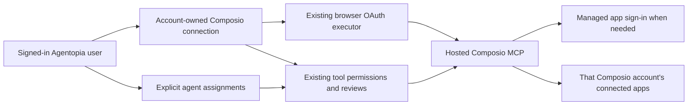

# Composio: hosted-account alternative and detailed source audit

Date: October 24, 2026. Scope: the optional route where each Agentopia user brings an existing Composio account through hosted MCP. After inspecting the subsequently supplied quickstart and session-MCP documentation, the primary application recommendation is **Platform sessions over MCP**. See [the final gap analysis and implementation plan](composio-account-integration-plan148.md). This document retains the detailed source audit and the alternative's implementation implications. The full desktop parity goal remains active.

## Finding and approach for this alternative

The current Composio feature implements the developer REST API. It requires a project key, creates application-specific user identities and connected accounts, fetches individual tool schemas, and executes actions directly. That is a supported integration approach, but its onboarding does not deliver the requested hosted-MCP experience. The Plugins card's “Connect” button currently leads to developer-project setup.

For the optional bring-your-own-Composio-account route, use the existing MCP client and browser OAuth executor against `https://connect.composio.dev/mcp`, with an explicit connection owned by the signed-in Agentopia account. Let that user select the agents that may use it. Keep upstream app sign-in with Composio's managed connection links. No end-user developer project key, separate unattended account or additional SDK is needed for this alternative.

This recommendation follows the user's requested MCP approach. Composio also documents an application-session integration using an application-controlled project key and stable per-user IDs. MCP is a protocol and can be used by both approaches; merely changing a REST URL to an MCP URL would not implement account ownership, sign-in or the user experience.

Sources: [Composio Connect](https://docs.composio.dev/docs/composio-connect), [authentication](https://docs.composio.dev/docs/authentication), [sessions versus direct execution](https://docs.composio.dev/docs/sessions-vs-direct-execution).

## What was inspected and demonstrated

The ordinary installation remains checkpoint146, Agentopia0.44.76/schema83, with complete recovery installer147 retained. Ten relevant source files match the accepted source behind that installed build. The compiled OAuth/network modules used in the discovery probe were extracted from the installed archive, avoiding an older working build directory. Source matches and receipt hashes are recorded in `.supabase/desktop-hosted-composio148/gap-analysis-evidence.json`.

Actual findings from live public discovery:

- The installed Electron44.7.2/Node24.21.0 network helper failed before HTTP with `ERR_INVALID_IP_ADDRESS`. Node requested an array of addresses through `lookup(..., {all:true}, callback)`, while the helper returned the single-address callback form. Existing local OAuth fixtures used numeric loopback addresses and did not exercise that hostname path.
- A new regression using a real `localhost` HTTP server failed on the accepted146 build with the same error. The candidate changes one compiled module, `mcp-oauth-network.js`, to return the checked address in the requested callback format. Address validation and pinning remain in place.
- All21 existing-plus-new OAuth tests pass against the candidate archive. They cover the hostname regression, ownership and assignment checks, callback/state/code-exchange behavior, refresh/reopening, private destinations and response limits.
- The candidate's Electron runtime reached the real Composio endpoint. It returned401 with a public protected-resource metadata URL; both protected-resource and authorization-server metadata returned200. The endpoint advertises public-client registration, authorization-code flow, refresh-token flow and PKCE S256, which protects the browser authorization exchange.
- Public metadata identifies resource `https://connect.composio.dev/mcp`, authorization at `https://connect.composio.dev/oauth/authorize`, registration at `https://login.composio.dev/oauth2/register`, and token exchange at `https://login.composio.dev/oauth2/token`. These are observations, not endpoints to hardcode in place of discovery.

The candidate is **not installed**. No client was registered, browser authorization completed, Google account connected, model request submitted or external app action executed in these probes. Discovery proves reachability and advertised prerequisites; it does not prove successful consent, refresh tokens, Google access or the final workflow.

## Gap analysis

| Area | Existing implementation and evidence | Required change | Priority |
| --- | --- | --- | --- |
| Main connection experience | `desktop/ui/ComposioPage.tsx` gates catalog access on `status.configured`; `ComposioConnectionCard.tsx` equates configured with a project key. | Show **Connect Composio** for the signed-in user, opening browser OAuth. Show connection/reconnect/disconnect state independently of legacy project setup. | Required |
| Transport and authentication | `composio-client.ts` calls `/api/v3.1/*` with `x-api-key`; `composio-connections.ts` requires a protected owner-specific key. | Use the discovered hosted MCP endpoint with the user's OAuth bearer credential. Preserve the old API route explicitly for existing connections during transition. | Required |
| Public-host OAuth | Installed DNS callback fails in both Electron and the hostname regression. Candidate repair and real discovery pass. | Deliver the one-module repair before hosted OAuth acceptance. | Prerequisite; candidate ready |
| Connection ownership | REST state/key are already bound to the Agentopia user UUID. Its upstream identity is `agentopia_` plus a hash of owner and project namespace. Generic MCP credentials are instead scoped by owner, agent and connection, with a separate creation-draft scope. | Add an explicit account-owned MCP connection and credential scope. One user's token must never resolve under another user or a fabricated agent ID. | Required |
| External identity | The REST-generated application user and the human identity signing into hosted Composio are different identity systems. | Bind the completed OAuth grant to the initiating Agentopia owner. Show a verified external account label only if the provider supplies it through a documented, validated mechanism. Existing app authorizations must be checked in the new connection; do not assume they transfer. | Required |
| Agent access | REST connections have per-connection agent assignments. Generic MCP configuration and plugin links are per agent. | Keep one account credential, with separate explicit assignments for agents. Recheck ownership, assignment and current grant immediately before calls; invalidate affected in-flight work and cached tool lists when access changes. | Required |
| Upstream apps | The REST path creates auth configurations and connection links itself. Hosted Composio exposes connection-management tools. | Use the hosted connection tools and render their returned sign-in links; distinguish “Composio connected” from “Google connected.” Wait or resume after actual app authorization. | Required |
| Discovery and execution | Direct REST fetches toolkit tools and executes each action. Generic MCP can list and call server tools, but locally filters discovery by tool name/description. | Expose Composio's returned meta-tools reliably. A search for “Google Drive” must reach Composio's search tool rather than disappear in the local name filter. Carry returned session IDs within the owning chat/task. | Required |
| Permissions and nested actions | Existing MCP review shows the wrapper tool and JSON arguments and rechecks authority before execution. Hosted multi-execution can contain many upstream actions; remote workbench/bash can execute further operations. | Preserve Chat only/Default/Full access behavior, display actual nested actions in reviews, and enforce any retained app/account restrictions across all execution routes. Unknown nested scope must not silently broaden access. | Required |
| Refresh and reconnect | OAuth executor already persists encrypted tokens, coalesces refresh, detects changed grants and supports reconnect. The live server advertises `offline_access` only in authorization metadata; resource metadata and the401 challenge provide no scope list. Current scope selection may therefore omit an explicit refresh scope. | Declare the provider-appropriate scopes through the reviewed connection configuration, confirm actual refresh-token behavior, and test reopening. Do not claim refresh support from metadata alone. | Required |
| App sign-in and errors | Generic MCP can return connection-link text, but structured `input_required` is converted into a generic failure. Tool failure output also becomes a general warning about uncertain execution. | Preserve actionable authorization-required state and surface the link without replaying an uncertain write. User cancellation/expiry must leave a clear reconnect/resume state. | Required |
| Google editor opening | `google-documents.ts` depends on REST `status`, `userConnection`, tool-schema fetch, `uploadFile` and direct execution. It tracks the source file, account binding, creation marker and readback to prevent duplicate uploads. | Adapt this concrete workflow to verified hosted tools/file-transfer support while preserving its journal and readback. Connecting MCP alone will not migrate the editor button. | Required for Google parity |
| Storage and recovery | `Secrets` encrypts local credentials for Windows; REST state is owner-keyed. Portable settings include public Composio metadata and require re-verification; tokens/keys are separate. | Keep hosted credentials encrypted and owner-scoped. Preserve reconnect metadata in recovery, and require new authorization where Windows-bound credentials cannot be restored. Keep old connections and upload journals until the replacement passes. | Required |
| Demonstrated end-to-end capability | Existing controlled tests establish substantial local behavior. This audit has real public discovery, but no authenticated hosted tool result. | Demonstrate sign-in, tool discovery, a verified Google action, account isolation, cold reopen and one bounded check through each AI provider. | Acceptance still pending |

Code locations: [REST client](F:/Agentopia/desktop/src/composio-client.ts:9), [owner-bound REST connections](F:/Agentopia/desktop/src/composio-connections.ts:24), [MCP OAuth scope](F:/Agentopia/desktop/src/mcp-oauth-scope.ts:4), [OAuth executor](F:/Agentopia/desktop/src/mcp-oauth.ts:55), [MCP target ownership](F:/Agentopia/desktop/src/mcp-oauth-connections.ts:16), [tool execution](F:/Agentopia/desktop/src/remote-tools.ts:98), [Google workflow](F:/Agentopia/desktop/src/google-documents.ts:16), [encrypted settings](F:/Agentopia/desktop/src/secrets.ts:6).

The official hosted interface currently documents seven meta-tools. Its multi-execution tool can run up to50 actions, and connection management can initiate or replace connections. Those behaviors need appropriate review and account binding. Public metadata advertises identity/refresh scopes, not separate per-app access scopes; per-app restriction support must be established through actual service behavior. Sources: [hosted tools](https://docs.composio.dev/docs/composio-connect), [connection management](https://docs.composio.dev/toolkits/meta-tools/manage_connections), [multi-execution](https://docs.composio.dev/toolkits/meta-tools/multi_execute_tool).

## Intended user experience

1. Sign into an Agentopia account and open **Plugins → Composio**.
2. Select **Connect Composio**, sign into the intended Composio account in the browser, then return to Agentopia. No developer-key field appears in this flow.
3. Select which owned agents may use this account connection. The default must be explicit; do not automatically grant every agent access.
4. Ask an assigned agent to use an app. If the app needs authorization, Agentopia presents the Composio connection link and resumes after it is connected. If already connected, use that account without an unnecessary new sign-in.
5. See connection state and relevant app/account information, change agent access, reconnect, or disconnect from the same page. Signing into another Agentopia account shows that account's connections only.



## Implementation sequence

The steps below extend current paths. Do not introduce a new OAuth library, inference provider adapter, global credential, synthetic service agent or separate connection framework. Implementation details for live provider schemas remain conditional on discovery; they must not be guessed in advance.

### 1. Deliver the transport prerequisite

**Files:** `desktop/src/mcp-oauth-network.ts`, `desktop/tests/mcp-oauth.test.cjs`, existing desktop package/install controllers.

The complete product change is the callback selection already in the candidate:

```typescript
lookup: ((_host: any, options: any, callback: any) =>
  options.all
    ? callback(null, [selected])
    : callback(null, selected.address, selected.family)) as any
```

The address was resolved, checked and selected before this callback. Keep that order. Preserve the failed installed receipt and the passing candidate receipt. Verify only `mcp-oauth-network.js` changes in the archive and that UI/schema/resources are unchanged. Reuse the existing recoverable archive replacement, capture logical data plus the closed profile, reopen normally, and compare database rows and protected connections. Test discovery again through the ordinary installation. No model call is necessary for this step.

**Already run:** `node scripts/desktop/prepare-hosted-composio148.mjs` (compiles/freeze/tests) and `node scripts/desktop/inspect-hosted-composio148.mjs --candidate` (live public metadata). Their current receipts exist. Inspect them before considering any rerun.

### 2. Add account ownership without moving existing credentials

**Files:** `desktop/src/composio-contracts.ts`, `composio-connections.ts`, `mcp-oauth-scope.ts`, `mcp-oauth-connections.ts`, `broker.ts`; corresponding OAuth/Composio tests.

Add a discriminated account-connection scope alongside the current saved-agent and creation scopes. Include the canonical owner UUID, a connection UUID, fixed reviewed hosted endpoint and a grant/configuration revision. Store the new credential under a separate owner-and-connection key. Keep REST keys/state in their existing namespaces. The broker must derive the owner from the authenticated session; renderer/model input cannot choose another owner.

Keep account connection metadata and selected agent IDs in the existing encrypted per-user Composio store, with a versioned validated format. This matches the current Windows desktop storage path and avoids a new database table for data that does not require one. Maintain backward parsing of the existing REST format. If a later demonstrated requirement needs SQL-queryable sharing, add that separately with the existing ownership checks; do not prebuild it here.

A proposed **metadata-only** shape is:

```typescript
type HostedComposioConnection = {
  mode: 'hosted-mcp';
  id: string;
  owner: string;
  endpoint: 'https://connect.composio.dev/mcp';
  revision: number;
  agentIds: string[];
};
```

Tokens, client registration and token expiry remain in the existing OAuth record, not this public/UI shape. Derive connection state from actual grants and handshake outcomes rather than a `configured` boolean.

**Acceptance:** connect under account A; account B cannot see, replace, refresh or use A's grant. Switching users during browser sign-in rejects the callback's save. Removing one agent's assignment denies the next call and cancels affected work without disconnecting other assigned agents. No changes to existing REST connections. Verify TypeScript plus focused ownership/cancellation tests using an isolated build, never the stale working build directory.

### 3. Replace the primary Composio onboarding

**Files:** `desktop/ui/ComposioPage.tsx`, `ComposioConnectionCard.tsx`, `composio.css`, `desktop/src/broker.ts`.

Replace the primary developer-key setup with **Connect Composio**, connection status, reconnect/disconnect and owned-agent selection. Keep the existing developer integration reachable under a clearly named legacy/advanced area while it has saved connections. Do not present both modes as one ambiguous connection count. Reuse the existing browser-open callback, sign-in cancellation and OAuth executor. Set and verify the hosted route's required scopes, including refresh access where required.

For connected apps, use documented hosted connection-management responses and display only fields actually returned. Where the service does not supply a complete app inventory, offer **Connect an app** and show observed connections instead of recreating a project-key-backed catalog behind the new screen.

**Acceptance:** a fresh user can reach browser sign-in without a key, custom OAuth client ID or project creation. Cancel/expiry/restart gives a usable retry state. User A's page disappears on switching to B. Completing consent establishes a real MCP `initialize` and `tools/list`; the interface may say “Connected” only after that handshake succeeds. Keep the returned authorization URL and token material out of ordinary logs.

### 4. Connect the hosted tools to agents and chat

**Files:** `desktop/src/remote-tools.ts`, `tool-contracts.ts`, `composio-connections.ts`, `broker.ts`; existing tool permission/review components and focused tests.

Resolve the account connection only after checking the current owner and the requesting agent's assignment. Reuse `withMcp`, schema validation, argument review, credential redaction, grant fingerprints and immediate pre-dispatch checks. Ensure local discovery exposes the hosted search/connection meta-tools even when a user query names an upstream app. Preserve service-returned session IDs by owner, chat/task and connection grant; never use one shared session across unrelated chats.

Render genuine connection-required responses as a sign-in handoff. Resume only after active state is confirmed. Keep uncertain writes held for readback; authorization failure must not cause blind replay.

Show each nested requested action, target app/account and arguments in the existing review. Preserve any explicitly configured per-app/account restriction; a single gateway assignment must not silently broaden an old agent's permissions. Inspect the live schemas before implementing nested validation. Remote Bash/workbench cannot bypass the same restrictions. If the hosted service cannot express the restrictions, reject the unsupported route for that restricted agent and explain the supported access level. Offer any broader account-wide grant explicitly; do not claim unsupported per-app enforcement.

**Acceptance:** one assigned agent discovers and calls a real read tool; an unassigned or different-owner agent is denied before network dispatch. Default asks once for the actual operation; Full access follows the user's standing scope; Chat only exposes no callable tools. Assignment/disconnect changes while a review is open invalidate it. Test nested multi-action and script paths against the retained restrictions. Routine model verification uses ChatGPT OAuth; run one bounded OpenRouter check only after this path works.

### 5. Move the Google editor workflow across the same connection

**Files:** `desktop/src/google-documents.ts`, `google-document-contracts.ts`, `composio-connections.ts`; current workspace editor handlers and Google-document tests.

First establish the real hosted Google Drive/Docs tool schemas and account identifiers. Confirm whether the hosted route supports the selected local file's required staging/upload/conversion. Browser OAuth does not prove this file-transfer capability. Keep the existing upload journal and separate legacy authority resolver. Add hosted execution only for demonstrated tool/file contracts; do not send a hosted OAuth token to REST routes that expect a project key.

Preserve selection consent, source-byte hash, owner/connection binding, the durable pre-create marker, uncertain-result hold and readback of the created Google file. Account changes require new authority; they must not reuse an old upload's binding. If hosted file staging is unavailable, record that precise missing operation and assess the existing authorized browser-upload path. A Google text-document creation test alone must not be reported as Word/Excel/PowerPoint transfer parity.

**Acceptance:** under a human-authorized Google account, perform a harmless read first, then create a clearly identified test document and read its contents back. Separately select a small local file and verify the actual transfer/conversion and returned editor URL. Repeat appropriate checks for Docs/Sheets/Slides. Simulate a lost create response and confirm readback finds the existing file without creating another. No external messages, sharing changes or unrelated account data are part of this test.

### 6. Recover, install and retire obsolete onboarding

**Files:** `desktop/src/portable-settings.ts`, `composio-contracts.ts`, existing recovery and installation scripts/tests; Composio UI and full goal status table.

Include validated public hosted metadata/assignments in portable recovery. Restore account ownership and require reconnection where Windows encryption cannot recover credentials. Test normal cold reopening without another consent when the grant is usable, then real refresh/reconnect behavior. Keep API-backed connection metadata, upload journals and credentials intact until replacement acceptance and an explicit user choice to remove them. OAuth authorization under a human Composio account may require reconnecting upstream apps formerly stored under the REST-generated application user.

Package and install the passing slice through the existing recoverable updater path. Verify ordinary UI, database/accounts/history, both AI connections, per-user Composio state and the same successful Google operation. Update the complete installer to the delivered payload; the existing147 installer remains a recovery artifact for146 until then. Final automatic updater distribution still needs the planned incremented release version.

**Acceptance:** both original Agentopia accounts and saved data survive; Composio credentials cannot cross accounts; no completed or uncertain external operation replays after restart/recovery; connected OAuth/OpenRouter behavior stays available. Only then remove the obsolete key-first default UI. Broader unsupported service features stay explicitly pending.

## Keeping the work small and reviewable

Deliver the prerequisite, account connection, agent tool use, and Google transfer as separately verifiable slices in that order. Reuse the pinned MCP SDK, current encrypted settings, existing permissions and journals, and current package/recovery machinery. Avoid a second OAuth engine, duplicate credential stores, a new inference harness, invented app APIs or a wholesale plugin rewrite. A phase is done when its stated user-visible behavior passes; additional cases should address a changed path or reproduced failure.

Rollback uses the retained archive and closed profile/logical recovery from each installation. Metadata changes are additive and versioned; old credentials are not silently rewritten or revoked. If authorization or a write has an uncertain result, inspect that operation before another dispatch. Reverting local code does not undo a completed external action.

## Current completion boundary

Delivered now: source/installed-state gap analysis, this ordered implementation plan, a reproduced public-host OAuth defect, a one-module packaged candidate repair,21 passing local OAuth tests, and real unauthenticated Composio metadata checks in Electron.

Still required: installed repair, account-owned hosted connection, completed human OAuth, agent assignment/use, actual refresh and reconnect, Google editor/file-transfer acceptance, recovery and final installer delivery. The plan is saved and ready to execute; it does not claim the replacement integration is already delivered.
