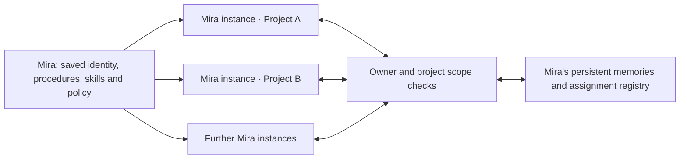

# Persistent agents in Agentopia

Available in installed Agentopia 0.44.63. Earlier installed-app ChatGPT checks verified saved roles, procedures and skills, cross-project memory recall, identity isolation and restricted delegation. Six actual ChatGPT requests on57 additionally verified a named specialist retrieving its private checkpoint and automatically reporting to the original parent thread; cold reopening preserved the result without replay.59 retains the completed answer outside collapsed activity, opens its inline citation beside chat and includes the later reports when copying the response. See [actual live workflow](live-named-specialist57.md), [visible replies](visible-parent-replies58.md) and [controlled recovery and duplicate suppression](named-agent-reports57.md). Longer assignments and unattended behavior remain separate verification work.

Create an agent in the Agents library, then open its settings. General settings hold its name, instructions and default connection/model. Behavior settings hold its mention handle, role, standard operating procedures, written guardrails and persistent skills. Saving a definition creates a new revision, so saved responses retain the identity and revision that produced them.

Type `@` in the message composer and choose the agent. It becomes the active agent for that chat until you switch again. The chat, draft, project and selected model remain in place. The sidebar's agent selector also switches the active agent. You can send a leading address such as `@mira, review the saved decision`. Use the unique handle when display names are ambiguous. Email addresses, quoted text and code remain ordinary message text.

Each independent assignment creates an instance of the saved agent. All Mira instances share Mira's identity and authorized memory. They have separate working contexts, conversations and saved execution states. An idle central identity consumes no model requests. Instances inspect the central record through tools when they need to learn what other instances are doing.

For example, ask Mira: “Inspect your current assignments across my projects. Report the saved status, cite the relevant work, and distinguish completed results from work still running.” Mira can list her instances and read their saved transcripts and tool receipts. A saved checkpoint reports what an agent said; a completed tool receipt records the corresponding observed action. Private unsaved reasoning is not exposed.

An agent can call another saved agent with `invoke_agent`, including a distinct instance of itself for another task. The target uses its own definition and tool restrictions. The selected provider/model follows the requesting chat, and the target receives permissions within both agents' limits. A task is visibly queued until a native runtime accepts it. The caller can wait up to 30 seconds or return while the specialist works independently. The specialist's final result then resumes the original parent Codex thread automatically, retaining its agent, project, connection, model and permissions. The parent can also read the result explicitly. A complete read of the final public result suppresses the pending automatic report; an early or partial read keeps the later completion report available. Nested specialist work must finish before its final result is reported.

The Memory section of agent settings shows saved notes and assignments. You can inspect sources, correct or forget a note, read saved work, open an assignment and stop work. User corrections are labelled separately from agent-authored notes. Forgetting removes the note and its saved versions; the source conversation remains in history. Changes stop affected work where necessary so later responses use current context. Sources retrieved through tools remain subject to visibility and revision checks before later model requests.

By default, an agent can retrieve her own memory across your projects. Enable **Isolate agent memory for this project** in project settings to keep that project's agent memory and work within its own scope. The Memory panel has an explicit project selector for inspecting isolated work. Other users' records remain inaccessible, and another saved agent does not inherit Mira's private memory.

Written procedures and guardrails guide the model. The tool and delegation controls enforce access: you can allow exact tool names, disable memory reads or writes, choose permitted specialists and limit delegation depth and total delegated turns. These controls also apply to delegated instances. Chat only mode disables agent memory and delegation tools along with other external operations.

Stopping an assignment also stops its named descendants and reports addressed to it; unrelated instances keep working. The chat's Workspace agent reports panel shows pending work and reports that require review. A running report has its own activity and Stop control, while your draft remains editable. Completed source responses remain in their saved history.

Restart recovery preserves saved work and holds unfinished reports for review. Agentopia does not automatically repeat an uncertain request. Use Continue report for work confirmed not submitted; inspect the saved report before retrying a possibly submitted attempt. Confirming a successful saved report records completion without another model request. Execution requires Agentopia and its local runtime to be running.

Retiring an agent preserves its historical authorship and shared conversations while disabling new assignments.

On installed 0.44.62, an actual named specialist read the selected image and its own saved checkpoint. A separate chat using the parent identity read the specialist's running status and cited its child chat. The child later reported its role, visual findings and checkpoint automatically on the original parent native thread, while the unsent draft remained intact. Normal reopening retained the completed work without further model requests. The observation interval briefly held delivery of the child's real response, so the result establishes assignment status and public activity rather than access to private reasoning. An extra failed-assignment inspection used an invalid parameter and remains unverified. See [live child vision and status evidence](live-child-vision-status62.md) for setup, request counts and limits.

Five actual concurrent specialist chats on the same installed release also passed scoped Stop, steering to a revised answer, a once-only queued follow-up, an independent draft and normal closure/reopening. The test held real response delivery to establish the control window; the pre-header steering hold had to be released before the revision advanced. These are bounded control checks, with longer work and already-streaming interruption still open. See [live five-chat controls](live-concurrency62.md).

Installed63 actual streaming verification passes: Stop interrupts a visible response, steering reaches the same native turn, and another agent can finish its invoice and queued follow-up while a stopped chat retains its draft. Cold reopening preserves those results without replay. This bounded test covers three concurrent streams and five real model responses. [Evidence](live-streaming63.md).

On installed 0.44.63, a named specialist used its own saved policy and assigned skill to process a selected 20,000-row ledger, ran one real scoped command, and saved an agent-authored checkpoint with its original assignment source. The parent read the output and delivered its automatic report in the original native thread. All 4,286 accepted rows and the exact currency total were independently checked. Cold reopening retained the roles, skill, memory, files, report and unsent draft without inference replay. The initial test-checker failures and distinct recovery requests remain recorded. See [actual combined autonomous work](live-mixed63.md).

Installed63 also passed a real-clock scheduled continuation after normal app close/reopen before its due time. One occurrence resumed the retained read-only specialist and its existing native thread, recalled the original checkpoint and source, preserved the visible other chat and both drafts, and passed cold inspection without replay. This is bounded schedule/restart evidence; hours-long unattended operation and Windows reboot remain unverified. [Actual scheduled agent](live-scheduled-agent63.md).
